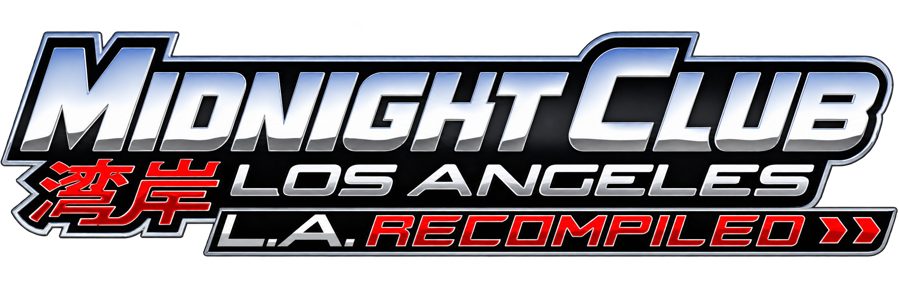
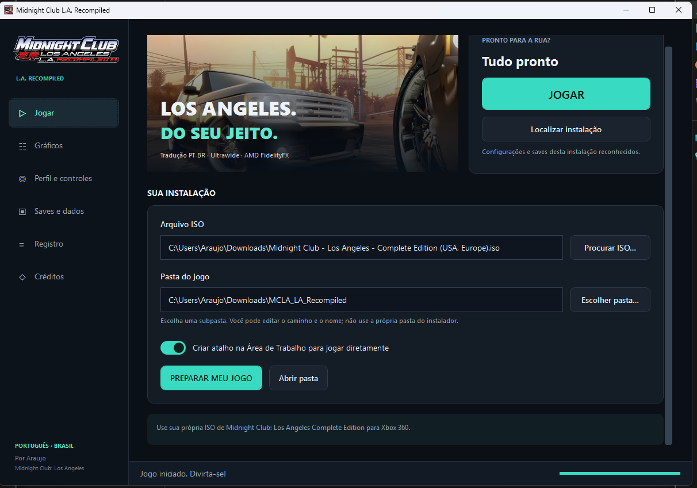
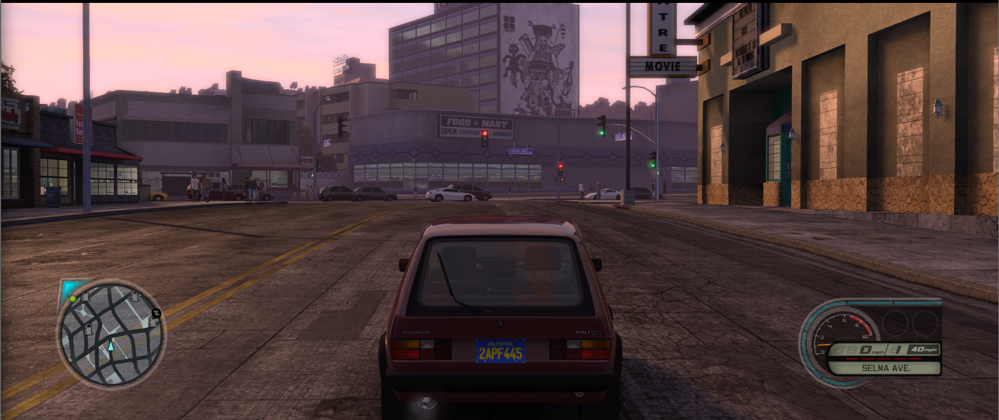
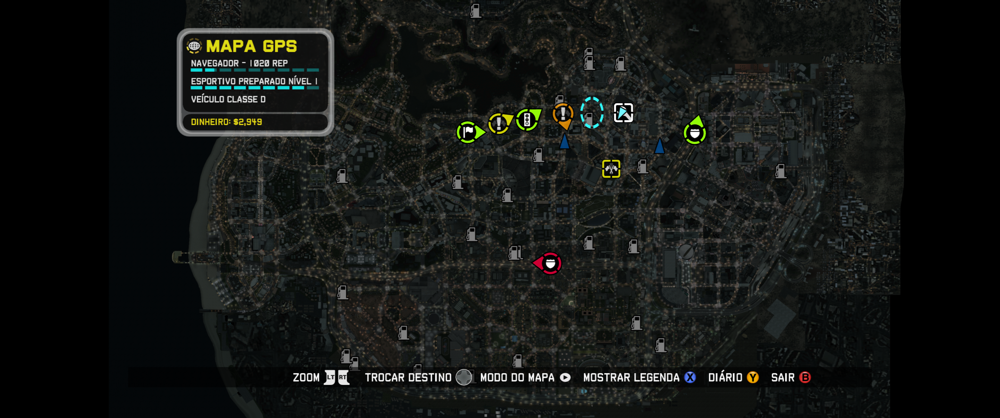
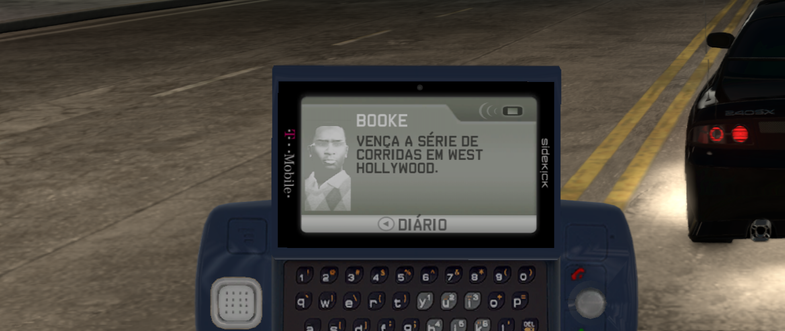
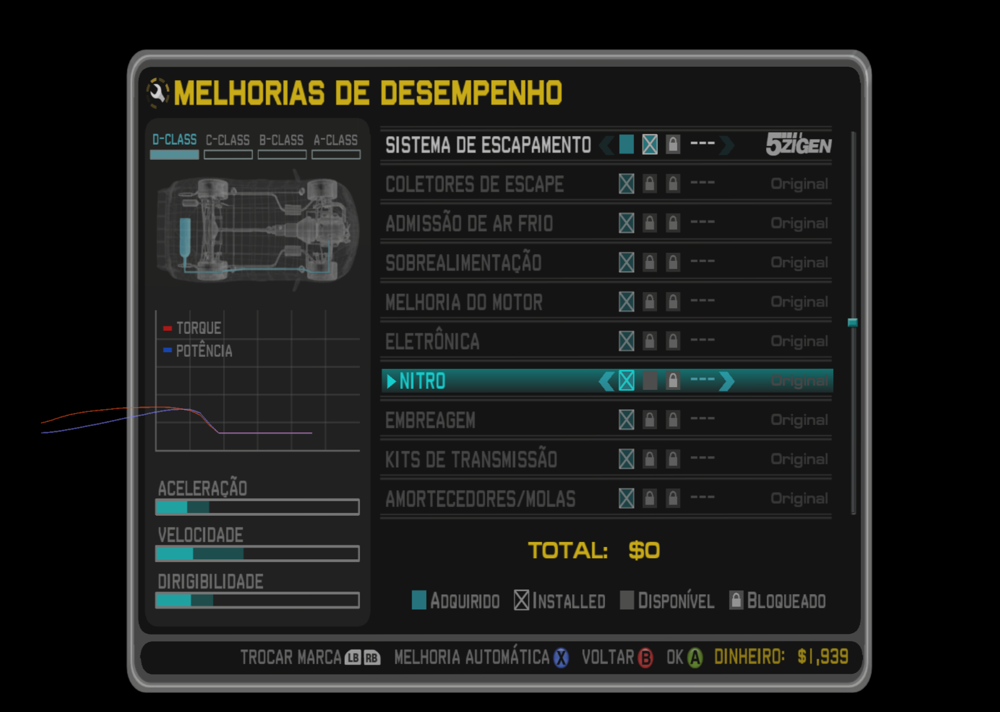

<h1 align="center">Midnight Club L.A. Recompiled</h1>

PT-BR • Proporção automática e ultrawide • AMD FidelityFX • Instalador e configurador

Projeto comunitário para jogar **Midnight Club: Los Angeles Complete Edition** no PC com melhorias de imagem e interface, mantido por **Araujo**.

A recompilação original é de [holdmysocks](https://github.com/holdmysocks/mcla-recomp). A base direta é o fork de [RenanQueiroz](https://github.com/RenanQueiroz/mcla-recomp), com o runtime [ReXGlue](https://github.com/rexglue/rexglue-sdk). Este projeto preserva os créditos e licenças desses trabalhos. Não há afiliação com Rockstar Games ou AMD.

## Comece aqui

1. Acesse [Releases](https://github.com/robertoaraujo77/MC_LA_Recompiled/releases) e baixe o pacote da versão publicada.
2. Extraia o ZIP inteiro para uma pasta estável e abra **Midnight Club L.A. Recompiled.exe**.
3. Selecione sua própria ISO de **Midnight Club: Los Angeles Complete Edition para Xbox 360**.
4. Escolha a pasta do jogo. O padrão é uma subpasta ao lado do instalador; você pode mudar o local e o nome.
5. Deixe marcada a opção **Traduzir o jogo para português (PT-BR)** (padrão), ou desmarque para jogar em inglês.
6. Se quiser, ajuste **Gráficos** e **Perfil e controles** antes de preparar. Sem alterações, serão usados os padrões descritos abaixo.
7. Clique em **PREPARAR MEU JOGO**. A aba **Registro** mostra o andamento.
8. Ao terminar, clique em **JOGAR** ou use o atalho da Área de Trabalho.

**Já tem a v1.0.0?** Abra o novo executável, use **Localizar instalação** e clique em **Atualizar**. A ISO não é necessária e seus saves e configurações são mantidos.

**A ISO e os dados do jogo não são fornecidos.** O assistente prepara localmente os dados da sua cópia usando a versão PC já compilada com as melhorias. Ele não recompila C++ no computador do jogador. Mantenha a ISO fora da pasta de destino.

[Instalação detalhada](docs/INSTALACAO.md) · [Configurações](docs/CONFIGURACAO.md) · [Como as melhorias foram feitas](docs/MELHORIAS.md) · [Créditos](CREDITS.md) · [Compilar os fontes](docs/COMPILACAO.md)

## O que mudou

| Área | Melhorias |
| --- | --- |
| Idioma | Menus, telefone, dicas, missões, objetivos, garagem/customização, corridas e avisos em PT-BR; legendas traduzidas onde disponíveis. |
| Ultrawide | Automático, 16:9 e 21:9; HUD nos cantos, correções de proporção de telefone, garagem, painéis, GPS, ícones e cursor. |
| Reconstrução | FSR 4.1.2 (IA) **somente no DirectX 12**, em GPU AMD compatível; Native AA, Qualidade, Equilibrado e Desempenho. |
| Frame Generation | Provedor AMD 4.0.2 por IA **somente no DirectX 12**, em GPU AMD compatível; opção de ligar/desligar. |
| Vulkan | FSR 3.1 e seus modos. **FSR 4.1.2 e Frame Generation por IA não estão disponíveis em Vulkan**: o SDK da AMD não os oferece para essa API, e a opção de Frame Generation não gera quadros nesse modo. |
| Facilidade | Um mesmo executável instala, configura, inicia o jogo e exporta backup; atalho direto para jogar. |

Os números FSR identificam os provedores integrados. A seleção efetiva depende de GPU, driver e API e pode ser conferida no registro do jogo. Não há promessa de IA em todas as placas.

**Para usar FSR 4.1.2 e Frame Generation, escolha DirectX 12** em *API gráfica*. O modo Automático deixa o runtime decidir. Em Vulkan, deixe a Frame Generation desligada. O DLSS da NVIDIA não está implementado.

## Primeira instalação limpa

Nenhum save, nome de jogador do mantenedor, histórico ou configuração pessoal acompanha o pacote. O perfil inicial chama-se **User**. Saves novos são criados pelo próprio jogo.

| Opção | Inicial |
| --- | --- |
| Tela | Tela cheia, tamanho automático |
| Resolução interna | 720p (1×) |
| Antisserrilhado | MSAA |
| Limite / VSync | 30 FPS / ligado |
| Sombras e efeitos | Padrões do jogo, sem perfil de desempenho aplicado |
| Frame Generation | Desligado |
| Idioma / proporção / botões | PT-BR / Automático / Xbox |

Esses são os padrões desta distribuição, preservando as correções do projeto. Se você mudar as opções antes de preparar, suas escolhas serão aplicadas. Uma instalação existente pode carregar **os seus próprios** ajustes locais; isso não significa que o pacote inclua o histórico do mantenedor.

## Imagens

Capturas do desenvolvimento; opções e desempenho mostrados não representam os padrões iniciais nem uma garantia de FPS.

### Instalador e configurador

### Jogo em ultrawide

### GPS

### Telefone em português

### Customização

## Limitações conhecidas

- Testes realizados no Windows, incluindo RX 9060 XT e 3440×1440; outras combinações precisam de validação.
- Pode ocorrer uma linha verde discreta na borda em alta velocidade com Frame Generation. Desligá-lo eliminou o artefato nos testes relatados.
- Em Vulkan, FSR 4.1.2 e Frame Generation por IA não existem e a Frame Generation ainda não gera quadros. Use DirectX 12 para esses recursos.
- Há traduções e legendas que ainda exigem conferência durante toda a campanha. Não é dublagem.
- Nomes próprios, marcas e músicas permanecem no original.
- As melhorias não foram testadas no Linux.

## Licença e autoria

A licença do código deste fork é **GPL-3.0-or-later**; componentes de terceiros mantêm suas licenças. Veja [LICENSE](LICENSE), [CREDITS.md](CREDITS.md) e [THIRD-PARTY-NOTICES.md](THIRD-PARTY-NOTICES.md). Cada distribuição binária deve disponibilizar o código-fonte correspondente e os avisos exigidos. A interface simples para jogadores não altera essas obrigações.

O jogo, suas marcas, imagens e demais conteúdos pertencem aos respectivos titulares. Este projeto não concede direitos sobre a ISO nem distribui os dados extraídos dela.
